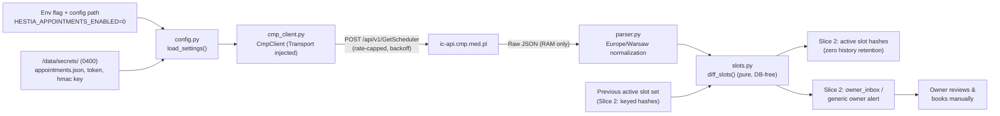

# Medical Appointment Slot Monitor — Design

> **Status:** Slice 1 (design + pure CMP client, parser, and slot-diff engine with synthetic fixtures; feature flag `HESTIA_APPOINTMENTS_ENABLED` default **OFF**). No web routes, background scheduler, database migration, or live portal calls ship in this slice.

## 1. Goals and non-goals

### Goals

- Detect sporadic newly opened or cancelled doctor-appointment slots on Polish private medical portals (starting with **Centrum Medyczne CMP**; **LUX MED** documented for a later slice).
- Evaluate candidate slots against explicit owner-configured watch criteria (specialty and/or doctor IDs, clinic/location IDs, date/time window, and an optional *"better than my currently booked appointment"* rule).
- Notify **only the Hestia owner** when a matching new or better slot appears, so the owner can review and book manually in the portal.
- Keep all medical-portal polling strictly server-side, conservative, rate-limited, and privacy-minimal under GDPR Art. 9.

### Non-goals

- **No automated booking, reservation, cancellation, or account mutation.** Hestia is strictly **notify-only**. The owner always books manually in the provider's portal or app.
- **No multi-user or household sharing.** Appointment watches, state, and notifications are strictly owner-private and never exposed to household members, global SSE (`/api/events`), or global `/api/audit`.
- **No medical records or patient PII.** Hestia never fetches, parses, or stores diagnoses, visit notes, lab results, prescriptions, PESEL numbers, patient IDs, or full patient names.
- **No live LUX MED implementation in Slice 1.** LUX MED is documented here with architectural options only.
- **No database migration, HTTP endpoints, UI, or poller wiring in Slice 1.** The diff engine stays pure and DB-free; persistence and notifications are designed here for Slice 2, where `holzera` assigns the Alembic revision number at merge.

---

## 2. Module boundary

The feature lives in a self-contained package `hestia/appointments/`, isolated from `hestia/budget/`, `hestia/auth*`, `hestia/api_contract.py`, and receipt modules.

| Module | Responsibility | Slice |
| --- | --- | --- |
| `hestia/appointments/config.py` | Feature flag (`HESTIA_APPOINTMENTS_ENABLED`), strict JSON config loader (`load_settings`), `0400`/`0600` secret-file reader, typed dataclasses for watches, booked slots, credentials, and poll policy. | Slice 1 (implemented) |
| `hestia/appointments/cmp_client.py` | Read-only CMP HTTP client (`POST /GetScheduler`) around an injectable `Transport` protocol, per-run request cap, spacing, `Retry-After` handling, exponential backoff with jitter, and fixed safe error codes. | Slice 1 (implemented) |
| `hestia/appointments/parser.py` | Pure CMP scheduler response parser normalizing all timestamps to `Europe/Warsaw` (DST-safe), counting empty days, and skipping malformed/unavailable entries fail-closed. | Slice 1 (implemented) |
| `hestia/appointments/slots.py` | Pure, DB-free slot-diff engine: criteria matching, "better than booked" evaluation, deterministic deduplication/sorting, and keyed HMAC/SHA-256 slot digests. | Slice 1 (implemented) |
| `hestia/appointments/store.py` | Minimal SQLite persistence for watch health and active slot hashes only (no history archive); Alembic migration assigned by `holzera` at merge. | Slice 2 (planned) |
| `hestia/appointments/poller.py` | Off-loop background poller supervisor (mirroring `hestia/budget/jobs.py`) driving jittered cycles and persisting cooldown deadlines. | Slice 2 (planned) |
| `hestia/appointments/notify.py` | Owner-private notification bridge feeding Hestia's `owner_inbox` pattern (and future `owner_push` / `owner_email` with generic non-sensitive copy). | Slice 2 (planned) |



---

## 3. Providers

### 3.1 Centrum Medyczne CMP (implemented in Slice 1)

Earlier passive recon identified CMP's patient-portal REST API:

- **Base URL:** `https://ic-api.cmp.med.pl/api/v1` (pinned HTTPS origin; redirects disabled; no credentials forwarded across origins).
- **Availability endpoint:** `POST /GetScheduler` (read-only availability query; never calls reservation or booking routes).
- **Deployment fit:** Pure HTTPS JSON API requiring no browser or Android emulator; runs directly on `holzera`.

#### Assumptions requiring live recon verification on `holzera`

No live network calls were made while writing Slice 1. Every wire-level assumption below is encoded against synthetic fixtures and **must be verified by `holzera`'s live recon before Slice 2 activation**:

| Area | Slice 1 assumption | To verify during live recon |
| --- | --- | --- |
| Authentication | Supports `auth_mode: "none"` (no header) or `auth_mode: "bearer"` (`Authorization: Bearer <token>` loaded from a `0400` file). | Whether `/GetScheduler` permits anonymous queries, requires a static/long-lived bearer token, or requires a login/refresh flow and session cookie; token lifetime and refresh endpoint. |
| Request payload | JSON body with `dateFrom` (`YYYY-MM-DD`), `dateTo` (`YYYY-MM-DD`), and optional `specialtyId`, `doctorIds` (list), `locationIds` (list), `serviceId`. | Exact field names and casing (`camelCase` vs `PascalCase`), scalar vs array types (`clinicId` vs `locationIds`), max allowed date span per request, and pagination behavior. |
| Response envelope | JSON object containing `days` array of `{ "date": "YYYY-MM-DD", "slots": [...] }` (plus optional top-level `specialtyId`). | Exact wrapper key (`days`, `schedules`, `data`, `items`, or root array) and whether empty dates are omitted or returned with `slots: []`. |
| Slot fields | `slotId`, `startTime` (ISO datetime or `HH:MM` paired with day `date`), optional `endTime`, `doctorId`, `locationId`, `specialtyId`, optional `doctorName`, `locationName`, `available` (bool, default `true`), `telemedicine` (bool, default `false`). | Exact field names, whether doctor/clinic IDs are integers or strings, whether unavailable slots appear in the list, and whether any slot-type flags (e.g. NFZ vs private/commercial) must be filtered. |
| Timezone semantics | Naive timestamps are wall-clock `Europe/Warsaw`; offset-aware timestamps (`Z` or `+01:00`/`+02:00`) are converted to `Europe/Warsaw`. Nonexistent DST spring-forward local times are rejected. | Whether CMP emits naive Warsaw wall-clock strings, UTC `Z` timestamps, or explicit offsets across CET/CEST transitions. |
| Error & rate-limit contract | `401`/`403` = auth failure (no retry); `429` and `5xx` = retryable with `Retry-After` (delta-seconds or HTTP-date) and exponential backoff; other non-200 = non-retryable. | Whether CMP signals expired auth or rate limits via HTTP status codes or soft HTTP `200` error envelopes, and what headers (`Retry-After`, WAF challenge pages) appear under load. |

### 3.2 LUX MED (documented only — do not implement in Slice 1)

LUX MED's web/API patient portal is protected by **Imperva (Incapsula)** bot detection, a dynamic **`pact`** request-integrity header, **XSRF** token binding, and mandatory **MFA** on login. Reverse-engineering or bypassing Imperva/`pact` checks is fragile, breaks frequently, and risks account lockout or Terms of Service issues.

#### Candidate fallback options for a later slice

| Option | Approach | Host | Pros | Cons / Risks |
| --- | --- | --- | --- | --- |
| **A (Recommended fallback)** | **Official LUX MED Android app driven by a phone harness** (`adb` + UIAutomator / Accessibility reader) on a local Android emulator (x86_64 KVM) or a dedicated spare physical Android phone tethered over USB. | **`branickiego` (Intel N97)** — *not* `holzera` (its CPU cannot run an Android emulator). | Uses the genuine official app; avoids Imperva/`pact`/XSRF re-implementation; owner completes MFA manually once per app session. | Sensitive to app UI layout changes; Play Integrity / root checks may reject emulators (favoring a cheap spare physical phone over USB); needs careful low-frequency scheduling and a private minimal push bridge back to `holzera`. |
| **B** | Owner-authenticated headed browser profile on a local machine with passive DOM inspection. | `branickiego` | Reuses a standard browser session. | Imperva behavioral/TLS fingerprinting still triggers challenges; session expiry and unattended stability are poor. |
| **C** | Native provider notifications / wait-list emails parsed through a dedicated mail rule (if offered). | `holzera` | Zero portal polling; lowest ToS and maintenance burden. | Dependent on provider wait-list support and typically slower than direct slot checks. |

**LUX MED design constraints when revisited:**

1. Keep the harness strictly read-only (search availability screen -> extract anonymized slot tuples -> send only minimal signed slot diffs to `holzera` over private LAN/WireGuard; never store screenshots or PII).
2. Enforce even more conservative cadence (e.g., 20–30 min jittered, daytime-only) and automatic pause on MFA/session expiry or unexpected screen state.
3. Do not begin LUX MED implementation until CMP has been validated end-to-end on `holzera`.

---

## 4. Data flow

1. **Startup / configuration load:** Hestia checks `HESTIA_APPOINTMENTS_ENABLED`. Unless it is `"1"`, `load_settings()` returns `None` without opening any files or scheduling work. When enabled, `load_settings()` reads the `0400`/`0600` JSON config (`HESTIA_APPOINTMENTS_CONFIG`) and any referenced `0400` secret files.
2. **Jittered poll trigger (Slice 2):** The off-loop poller sleeps a randomized interval in `[min_interval_seconds, max_interval_seconds]` (default 10–15 min), checks per-watch cooldown deadlines, and opens a single bounded `CmpRun`.
3. **Bounded provider query:** For each eligible watch (until `max_requests_per_run` is reached), `CmpClient.get_scheduler()` builds a `CmpSchedulerQuery` and sends `POST /api/v1/GetScheduler` with spacing, `Retry-After` handling, and exponential backoff on `429`/`5xx`.
4. **In-memory parsing:** `parse_cmp_scheduler_bytes()` parses the JSON strictly (rejecting duplicate keys and non-finite constants), converts valid available slots into `AppointmentSlot` objects in `Europe/Warsaw`, and drops raw response bytes immediately (never logged, never written to disk).
5. **Pure slot diff:** `diff_slots(previous, current, criteria)` filters both sets against `WatchCriteria`, deduplicates by canonical UTC instant + `(provider, doctor_id, location_id, specialty_id)`, computes `new_slots`, `removed_slots`, `better_slots`, and `notifiable_slots` in deterministic order.
6. **Minimal persistence & owner notification (Slice 2):** Persist only the current active `slot_digest` set (deleting removed/past hashes immediately) and surface `notifiable_slots` to the owner's private inbox / generic alert channel. The owner manually opens CMP to book.

---

## 5. Criteria configuration

Configuration is operator-managed via a local JSON file referenced by `HESTIA_APPOINTMENTS_CONFIG` (up to 16 KiB, mode `0400` or `0600`, regular file owned by the Hestia runtime UID, symlinks rejected). Unknown keys, duplicate JSON keys, and `NaN`/`Infinity` constants are rejected fail-closed.

### Example synthetic configuration

```json
{
  "owner": "example-owner",
  "auth_mode": "bearer",
  "auth_token_env": "HESTIA_APPOINTMENTS_CMP_TOKEN_FILE",
  "hmac_key_env": "HESTIA_APPOINTMENTS_HMAC_KEY_FILE",
  "poll_policy": {
    "min_interval_seconds": 600,
    "max_interval_seconds": 900,
    "max_requests_per_run": 6,
    "max_retries": 3,
    "base_backoff_seconds": 2,
    "max_backoff_seconds": 60,
    "min_request_spacing_seconds": 1
  },
  "watches": [
    {
      "watch_id": "cmp-checkup-1",
      "provider": "cmp",
      "label": "Checkup A",
      "specialty_id": "spec-01",
      "doctor_ids": ["doc-101", "doc-102"],
      "location_ids": ["loc-01"],
      "date_from": "2026-12-01",
      "date_to": "2026-12-31",
      "time_from": "08:00",
      "time_to": "17:00",
      "booked_slot": {
        "start": "2026-12-20T14:00:00+01:00",
        "doctor_id": "doc-101",
        "location_id": "loc-01",
        "min_improvement_minutes": 60,
        "require_same_doctor": false,
        "require_same_location": false
      },
      "only_better_than_booked": true
    }
  ]
}
```

### Field rules

- `owner`: required non-blank UTF-8 string (max 128 chars, no control chars).
- `cmp_base_url`: optional HTTPS URL without credentials, query, or fragment; defaults to `https://ic-api.cmp.med.pl/api/v1`.
- `auth_mode`: optional `"none"` (default) or `"bearer"`.
- `auth_token_env`: required iff `auth_mode == "bearer"`; env var name (`[A-Z_][A-Z0-9_]{0,127}`) holding the absolute path to a `0400`/`0600` regular file containing the ASCII token.
- `hmac_key_env`: optional in Slice 1 (recommended/required before enabling Slice 2 DB persistence); env var name holding the absolute path to a `0400`/`0600` regular file with `>= 32` random bytes, distinct from `HESTIA_SESSION_SECRET` and any auth token.
- `watches`: required list of 1..20 entries with unique `watch_id`s (`[A-Za-z0-9][A-Za-z0-9_.-]{0,63}`):
  - `provider`: `"cmp"` only in Slice 1 (`"luxmed"` is rejected).
  - `specialty_id` and/or `doctor_ids`: at least one must be provided.
  - `location_ids`: optional list of clinic/location IDs (empty means any location).
  - `date_from`, `date_to`: required `YYYY-MM-DD`, with `date_from <= date_to` and span `<= 180` days.
  - `time_from`, `time_to`: optional `HH:MM` wall-clock bounds in `Europe/Warsaw` (`time_from <= time_to` when both are set).
  - `service_id`: optional provider visit/service identifier.
  - `label`: optional short non-sensitive operator tag (max 64 chars). **Operators should use neutral tags** (e.g., `"Checkup A"`) rather than medical specialty or condition names.
  - `booked_slot`: optional currently booked appointment (`start` as ISO-8601 datetime — naive values interpreted in `Europe/Warsaw`, offset-aware converted to `Europe/Warsaw`; optional `doctor_id`, `location_id`, `min_improvement_minutes` in `0..10080`, `require_same_doctor`, `require_same_location`).
  - `only_better_than_booked`: boolean (default `false`; requires `booked_slot` when `true`). When `true`, `notifiable_slots` includes only newly observed slots that beat `booked_slot`; when `false`, all newly observed matching slots are notifiable while `better_slots` highlights those beating `booked_slot`.

### "Better than currently booked" rule

A slot $s$ is strictly better than `booked_slot` $b$ when:

1. If `b.require_same_doctor` is `true`, `s.doctor_id == b.doctor_id`.
2. If `b.require_same_location` is `true`, `s.location_id == b.location_id`.
3. Comparing UTC instants (DST-safe):
   - When `b.min_improvement_minutes == 0`: $s.\text{start}_{\text{UTC}} < b.\text{start}_{\text{UTC}}$.
   - When `b.min_improvement_minutes > 0`: $(b.\text{start}_{\text{UTC}} - s.\text{start}_{\text{UTC}}) \ge \text{timedelta}(\text{minutes}=b.\text{min\_improvement\_minutes})$.

---

## 6. Cadence and rate limits (ToS-friendly design)

To stay polite, predictable, and well within normal human browsing volume:

- **Conservative jittered polling:** Default interval is **10–15 minutes** (`min_interval_seconds=600`, `max_interval_seconds=900`, hard floor 300 s / 5 min). Each cycle draws a uniform random delay within `[min, max]` via `PollPolicy.next_poll_delay()` to avoid periodic clock-aligned spikes.
- **Per-run request cap:** Default `max_requests_per_run=6` (hard ceiling 20). Both initial requests and retries consume the same per-run budget; exceeding the cap raises `CmpRunLimitError` and defers remaining watches to the next cycle rather than bursting.
- **Inter-request spacing:** Default `min_request_spacing_seconds=1.0` between consecutive HTTP calls inside a single run (no parallel scraping threads or fan-out).
- **Exponential backoff with jitter on `429` / `5xx` / transient network errors:**
  - Retries up to `max_retries` (default 3, max 5).
  - Delay uses equal jitter: `exp = min(max_backoff, base_backoff * 2**attempt)`, `delay = exp * (0.5 + 0.5 * jitter())`.
  - **Honors `Retry-After`:** Parses RFC 9110 delta-seconds and HTTP-date headers and uses `max(delay, retry_after)`. If `retry_after > max_backoff_seconds`, the client stops immediately without sleeping and returns `retry_after` on `CmpClientError` so the Slice 2 poller persists a durable cooldown deadline.
- **Fail-fast on `4xx`:** `401`/`403` never retry; they raise `CmpClientError("authorization", attention="authorization")` so Slice 2 pauses polling and alerts the owner instead of hammering with expired credentials. `400`/`404` also fail without retry.
- **Read-only scope:** Only availability query endpoints are ever called; no reservation/checkout/captcha-bypass code exists.

---

## 7. Secrets

Secret handling mirrors `hestia/budget/config.py` (`_read_secret`), `hestia/budget/gmail_config.py`, and `docs/DEPLOY.md`:

- **Host location:** `./data/secrets/` (`chmod 0700`), already mounted at `/data/secrets/` inside the UID/GID `1000:1000` Hestia container (no new Docker volume required).
- **File permissions:** Provision with `chmod 0400` and owner `1000:1000`. The reader opens with `O_RDONLY | O_NOFOLLOW | O_NONBLOCK`, verifies `S_ISREG`, `st_uid == os.geteuid()`, mode in `(0o400, 0o600)`, and a strict byte ceiling (16 KiB). Symlinks, FIFOs, group/world-readable files, and foreign UIDs fail closed.
- **Files:**
  - `/data/secrets/appointments.json` — watch criteria and env var pointers (`HESTIA_APPOINTMENTS_CONFIG`).
  - `/data/secrets/appointments-cmp.token` — CMP bearer/session token when `auth_mode == "bearer"` (referenced via `auth_token_env`).
  - `/data/secrets/appointments-hmac.key` — 32+ random bytes (`os.urandom(32)`) for keyed slot hashing (referenced via `hmac_key_env`), verified distinct from `HESTIA_SESSION_SECRET` and the auth token.
- **Zero leakage:** `CmpCredentials` and `AppointmentsSettings` use `repr=False`. Exceptions emit only fixed safe error codes and never echo tokens, file paths, config fields, or raw HTTP payloads. Never commit secrets or paste them into chat/Iris/logs.

---

## 8. Data model and retention (planned for Slice 2)

**No Alembic migration ships in Slice 1.** When Slice 2 introduces persistence, **`holzera` assigns the next Alembic revision number at merge** (head at branch point `57a3395` is `0032_receipt_evidence_self_reference.py`) and shadow-verifies upgrade/downgrade per `docs/DEPLOY.md`.

### Planned minimal SQLite tables

1. **`appointments_watch_state`** — one row per `(owner, watch_id)`:
   - `owner TEXT NOT NULL`, `watch_id TEXT NOT NULL` (PK)
   - `status TEXT NOT NULL` (`'ok' | 'backoff' | 'auth_attention' | 'error'`)
   - `last_error_code TEXT NULL` (fixed enum from `CmpClientError.CODES` only — never response prose)
   - `consecutive_failures INTEGER NOT NULL DEFAULT 0`
   - `last_poll_at REAL NULL`, `next_poll_at REAL NULL`, `cooldown_until REAL NULL`
   - `updated_at REAL NOT NULL`
2. **`appointments_active_slots`** — current availability snapshot **hashes only** (no history):
   - `owner TEXT NOT NULL`, `watch_id TEXT NOT NULL`, `slot_hash TEXT NOT NULL` (PK — 64-char hex HMAC-SHA256 keyed with `appointments-hmac.key` over `(watch_id, provider, start_utc, doctor_id, location_id, specialty_id)`)
   - `slot_date TEXT NOT NULL` (`YYYY-MM-DD` in `Europe/Warsaw`, used only for expiry pruning)
   - `first_seen_at REAL NOT NULL`, `last_seen_at REAL NOT NULL`, `notified_at REAL NULL`
   - **No doctor names, clinic names, specialty names, or patient identifiers are stored in SQLite.**

### Retention rules

- **Zero slot history:** Whenever a slot disappears in a subsequent poll (`removed_slots`) or its `slot_date` is in the past, its row in `appointments_active_slots` is **hard-deleted immediately** in the same transaction.
- **Short expiry ceiling:** Even if polling pauses, a startup/periodic sweep purges any `appointments_active_slots` row whose `slot_date < today (Europe/Warsaw)` or `last_seen_at` is older than 7 days.
- **Watch removal / feature disablement:** Removing a `watch_id` from config prunes its rows on the next maintenance sweep; disabling `HESTIA_APPOINTMENTS_ENABLED` stops polling immediately, and an owner purge action (or schema downgrade) deletes all appointment rows.
- **Backups:** Encrypted SQLite backups on `holzera` contain only opaque HMAC hashes and coarse dates, minimizing exposure even at rest.

---

## 9. Notifications

Hestia already has an owner-private live alerts architecture in `hestia/budget/owner_inbox.py` (strictly allowlisted live alert params, deterministic ordering, opaque SHA-256 `subject_id`, anti-ABA read markers) and reserves `PRIVATE_DESTINATIONS = frozenset({"owner_inbox", "owner_push", "owner_email"})` (`hestia/budget/renewal_reminders.py`, `hestia/budget/mortgage_reminders.py`; see `docs/BUDGET_2D.md` and `docs/RELEASE_v1.8.0.md`). Currently `owner_inbox` is live in-app while outbound `owner_push` / `owner_email` delivery daemons remain future slices.

### Integration design (Slice 2+)

- **Reuse the owner-private inbox contract:** Surface active appointment alerts (`kind="appointment_slot"` and `kind="appointment_attention"` for `401`/`403` auth renewal) exclusively to the owning Hestia user.
- **Strictly allowlisted alert params:** e.g. `watch_id`, `slot_count`, `earliest_date`, `earliest_time`, `better_than_booked` (bool). Resolved alerts (once slots disappear or pass) disappear automatically even if unread, matching `owner_inbox` semantics.
- **GDPR-safe outbound push / email copy:** When outbound `owner_push` or `owner_email` is enabled later, third-party push relays (APNs/FCM) and SMTP servers must receive **generic, non-sensitive copy only** (e.g., *"Hestia: New earlier appointment slot found for watch `cmp-checkup-1`. Open Hestia to review."*). **Never** place medical specialty names, doctor names, clinic names, or health labels in push notifications, lock-screen previews, or email subjects/bodies.
- **Deduplication:** A slot's HMAC `slot_digest` triggers notification at most once while continuously available (`notified_at` set). If the slot disappears and reappears later, it is treated as a fresh opening.
- **Isolation:** Never emit appointment alerts to `/api/events` (shared household SSE) or `/api/audit`.

---

## 10. Privacy (GDPR Art. 9)

Information about medical specialties, doctors, or clinic visits sought by a named person can reveal **data concerning health** — a special category of personal data under **GDPR Article 9(1)**. Even on a self-hosted personal instance, Hestia applies strict Art. 9 controls:

1. **Server-side & owner-only:** Polling, parsing, diffing, and storage run exclusively on the owner's server (`holzera`) and are restricted to the single configured `owner` account. No household grants, no delegation, no public endpoints.
2. **Data minimization & zero history:** Raw portal responses stay strictly in memory and are discarded after parsing. Persisted state stores only keyed HMAC hashes of currently available slots and coarse dates — never historical schedules, never booking confirmations, never PESEL/patient IDs/medical notes.
3. **Zero sensitive telemetry:** Logs and error diagnostics record only fixed safe error codes (`network`, `rate_limit`, `authorization`, etc.) — never request payloads, response bodies, auth tokens, specialty IDs, or doctor names. Future HTTP routes must use opaque `watch_id`s and `POST` JSON bodies rather than `GET` query parameters so reverse proxies (Apache/Cloudflare) do not log health-related parameters.
4. **No third-party PII leakage:** Outbound traffic contacts only the explicitly configured medical portal (`ic-api.cmp.med.pl`). Future push/email alerts contain zero medical specifics.
5. **Mandatory privacy-policy gate before go-live:** **`ui/public/privacy-policy.html` (and `ui/public/terms-of-service.html` if needed) MUST be updated before setting `HESTIA_APPOINTMENTS_ENABLED=1` in production.** The update must document:
   - the optional, default-OFF appointment-availability monitor and its owner-only scope;
   - the external portal(s) queried (`ic-api.cmp.med.pl`, and later LUX MED if ever enabled);
   - that only minimal active slot hashes and watch health metadata are persisted (no medical records, no booking actions, no slot history) and how data is purged on disablement;
   - the GDPR Art. 9 notice for health-adjacent scheduling data.

---

## 11. Deploy target

| Component | Host | Rationale |
| --- | --- | --- |
| **CMP REST API monitor** (`hestia/appointments/`) | **`holzera` (prod)** | Lightweight HTTPS JSON client running inside the existing Hestia container (`UID 1000:1000`, `/data/secrets` mount). Needs no emulator or extra containers. |
| **LUX MED Android phone-harness fallback** (future slice) | **`branickiego` (Intel N97)** | `holzera`'s CPU cannot run an Android emulator. `branickiego` can host either a USB-tethered spare physical Android phone or an x86_64 KVM emulator and forward only minimal signed slot diffs to `holzera` over private networking. |

---

## 12. Rollout (default OFF, owner enables)

1. **Slice 1 (this PR — zero runtime impact):**
   - Ships `docs/APPOINTMENTS.md`, `hestia/appointments/` (`config.py`, `cmp_client.py`, `parser.py`, `slots.py`), synthetic fixtures, and 100% line+branch unit tests.
   - `HESTIA_APPOINTMENTS_ENABLED` remains unset (**OFF**). Nothing is wired into `hestia/web.py`, `hestia/server.py`, `hestia/db.py`, or any scheduler.
2. **Operator live recon on `holzera` (outside CI):**
   - Verify CMP `/GetScheduler` auth mechanism, exact request/response field names, timezone format, and rate-limit behavior against §3.1's Assumptions Table.
   - Adjust `cmp_client.py` / `parser.py` and synthetic fixtures if any wire field differs.
3. **Slice 2 (persistence, poller, owner inbox):**
   - Add minimal SQLite tables with Alembic migration number assigned by `holzera` at merge; run the full `docs/DEPLOY.md` shadow-verify upgrade/downgrade procedure on a DB copy.
   - Wire off-loop poller and owner-only inbox notifications behind `HESTIA_APPOINTMENTS_ENABLED=1`.
4. **Privacy-policy gate:**
   - Update `ui/public/privacy-policy.html` (and review `ui/public/terms-of-service.html`) for GDPR Art. 9 disclosure.
5. **Provision secrets on `holzera`:**
   ```sh
   install -d -m 0700 ./data/secrets
   umask 077
   python3 -c 'import os,sys; sys.stdout.buffer.write(os.urandom(32))' > ./data/secrets/appointments-hmac.key
   chmod 0400 ./data/secrets/appointments-hmac.key
   # Create ./data/secrets/appointments.json (and ./data/secrets/appointments-cmp.token if auth_mode=bearer), chmod 0400
   stat -c '%u:%g %a %s' ./data/secrets/appointments*   # expect 1000:1000 400
   ```
6. **Owner enables:**
   - Add `HESTIA_APPOINTMENTS_ENABLED=1`, `HESTIA_APPOINTMENTS_CONFIG=/data/secrets/appointments.json`, and any referenced `*_FILE` env vars to `.env`, then recreate the `hestia` container.
   - Verify dry-run/status check reports `configured=true` and observes conservative 10–15 min polling cadence.
7. **Rollback:**
   - Remove `HESTIA_APPOINTMENTS_ENABLED` (or set `0`) in `.env` and recreate the container — polling stops immediately. Optionally purge active slot hashes or run `downgrade_db` per `docs/DEPLOY.md`.

---

## 13. Open questions for the owner

1. **CMP live recon & auth (`Q1`):** Does `POST ic-api.cmp.med.pl/api/v1/GetScheduler` require patient authentication (bearer/cookie/login refresh) or allow unauthenticated availability queries? Please verify exact request/response JSON field names and timezone conventions from a real capture on `holzera` so we can confirm §3.1's assumptions.
2. **Notification channel for v1 (`Q2`):** Is Hestia's in-app `owner_inbox` sufficient for Slice 2, or do you want immediate outbound push/email alerts (with generic non-sensitive wording) from day one?
3. **Polling hours (`Q3`):** Should CMP polling run 24/7 (jittered 10–15 min) or restrict to daytime hours (e.g., `06:00–23:00 Europe/Warsaw`) to stay even lighter on the portal?
4. **"Better than booked" ranking (`Q4`):** Is *"strictly earlier by at least `min_improvement_minutes` (with optional same-doctor/same-location flags)"* sufficient, or do you want preference tiers (e.g., preferred doctor on the same day beats an earlier slot with another doctor)?
5. **LUX MED hardware choice (`Q5`):** When/if LUX MED moves to implementation on `branickiego`, do you prefer a spare physical Android phone over USB (avoids Play Integrity/emulator blocks) or an x86_64 KVM emulator?
6. **Privacy-policy naming (`Q6`):** Should `ui/public/privacy-policy.html` name Centrum Medyczne CMP explicitly as an optional external endpoint, or describe "owner-configured medical portals" generically alongside the GDPR Art. 9 disclosure?
